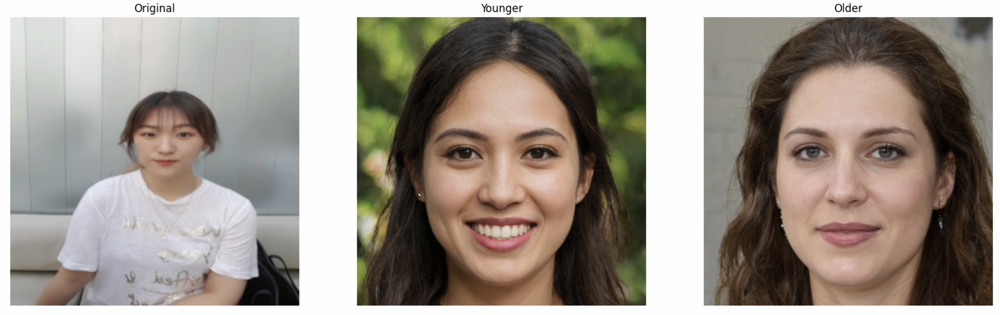
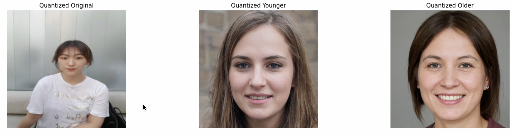
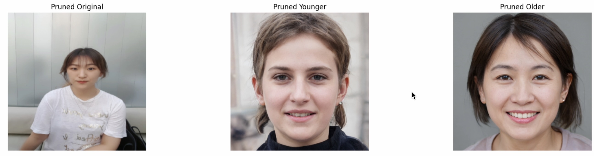

# Age Model

This repository documents iterative experiments on facial age transformation using a pretrained GAN-based generator.  
The project focuses on manipulating latent representations to control age-related attributes and examining how lightweight model optimization techniques affect visual quality.

Experiments were conducted in an interactive workflow, with repeated execution, parameter adjustment, and qualitative evaluation of intermediate results.

---

## Project Motivation
The goal of this project is to explore age progression and regression through latent space manipulation while preserving identity-related features.  
Rather than producing a single final output, the emphasis is placed on iterative experimentation and comparative analysis across different model configurations.

---

## Experimental Results

### 1. Baseline Age Transformation
The baseline experiment applies latent age edits to a pretrained generator without model optimization.  
The figure below shows the **original input** alongside **younger** and **older** variations generated from the same latent representation.

---

### 2. Quantization Experiments
To evaluate efficiency trade-offs, the generator was quantized and the same age manipulation procedure was repeated.  
Results are compared qualitatively against the baseline to observe changes in texture, smoothness, and age consistency.

---

### 3. Pruning Experiments
Structured pruning was applied to reduce model capacity while retaining core functionality.  
The resulting images highlight the impact of parameter removal on facial detail and age-related features.

---

## Observations and Insights
- Latent-based age manipulation produces consistent semantic age changes across all configurations.
- Quantization introduces minor smoothing effects but largely preserves age directionality.
- Pruning has a more noticeable effect on fine-grained textures, especially in extreme age shifts.
- Iterative visual inspection was critical for selecting reasonable age offsets and optimization levels.

---

## Tech Stack
- Python
- PyTorch
- Pretrained GAN-based generator
- GPU-accelerated execution (Colab-style environment)

---

## Repository Contents
- `Agemodel_colab_code.py` — main experimental script
- `images/`
  - `baseline_results.png`
  - `quantized_results.png`
  - `pruned_results.png`
- `README.md` — experiment documentation

---

## Notes
This repository represents an exploratory, experiment-driven project intended for portfolio development.  
The focus is on understanding model behavior through repeated execution and qualitative evaluation rather than producing a production-ready system.
